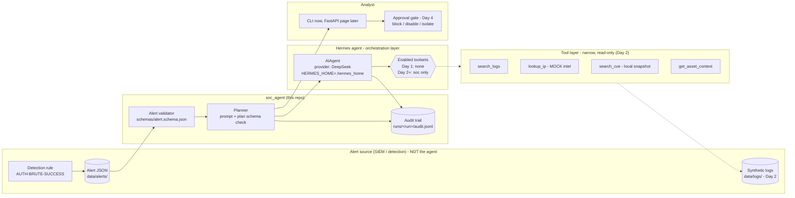

# Architecture

## Layers

## Who does what

| Layer | Responsibility | Not its job |
|---|---|---|
| SIEM / detection | Collects logs, runs deterministic rules, raises the alert. In this prototype it is represented by a synthetic alert file and (Day 2) synthetic logs. | Interpreting or explaining the alert. |
| Hermes agent | Reads the alert, plans the investigation, decides which approved tool to call next, interprets tool results, drafts the assessment. | Detecting threats, storing logs, or acting on production systems. |
| Tool layer | Narrow functions with JSON schemas and input validation that return evidence. Read-only. | Deciding what to do with the evidence. |
| Storage / audit | Append-only JSONL per run: prompt, model output, tool calls, timestamps, decisions. | — |
| Analyst | Reviews the plan/report and approves or rejects any disruptive action. | — |

## Safety decisions made on Day 1

- **Isolated Hermes home.** `HERMES_HOME` points at `.hermes_home/` inside the repo, so no personal Hermes config, memory, persona (SOUL.md) or context files are loaded.
- **Least privilege by toolset.** The agent is built with `enabled_toolsets=[]` on Day 1: the model can only return text. From Day 2 it gets only the `soc` toolset; Hermes' built-in terminal, file, browser and web tools are never enabled.
- **Schema at both ends.** Alerts are validated before they reach the model; the model's plan is validated after. A plan that names a tool outside the approved list is rejected, and the rejection reasons are sent back once for a corrected answer.
- **No action steps.** Containment (block IP, disable account, isolate host) cannot appear as a plan step; it goes to `safety_notes` and will require analyst approval (Day 4).
- **Authorized data only.** All data is synthetic: RFC 5737 documentation IPs (203.0.113.0/24), RFC 2606 domains (example.com), invented users and hosts. Every alert carries `data_provenance`.
