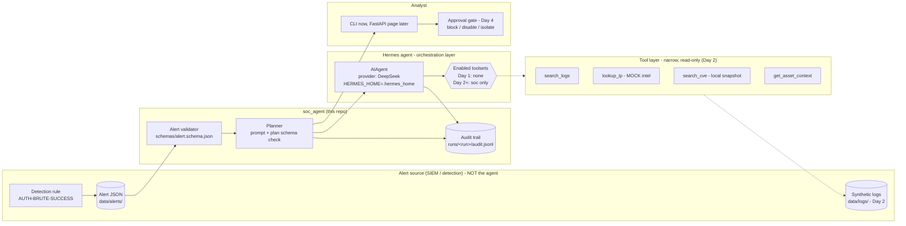
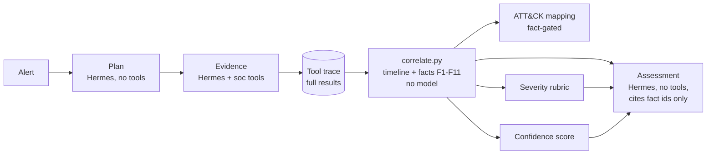

# Architecture

## Layers

## Who does what

| Layer | Responsibility | Not its job |
|---|---|---|
| SIEM / detection | Collects logs, runs deterministic rules, raises the alert. In this prototype it is represented by a synthetic alert file and (Day 2) synthetic logs. | Interpreting or explaining the alert. |
| Hermes agent | Reads the alert, plans the investigation, decides which approved tool to call next, interprets tool results, drafts the assessment. | Detecting threats, storing logs, or acting on production systems. |
| Tool layer | Narrow functions with JSON schemas and input validation that return evidence. Read-only. | Deciding what to do with the evidence. |
| Storage / audit | Append-only JSONL per run: prompt, model output, tool calls, timestamps, decisions. | — |
| Analyst | Reviews the plan/report and approves or rejects any disruptive action. | — |

## Safety decisions made on Day 1

- **Isolated Hermes home.** `HERMES_HOME` points at `.hermes_home/` inside the repo, so no personal Hermes config, memory, persona (SOUL.md) or context files are loaded.
- **Least privilege by toolset.** The agent is built with `enabled_toolsets=[]` on Day 1: the model can only return text. From Day 2 it gets only the `soc` toolset; Hermes' built-in terminal, file, browser and web tools are never enabled.
- **Schema at both ends.** Alerts are validated before they reach the model; the model's plan is validated after. A plan that names a tool outside the approved list is rejected, and the rejection reasons are sent back once for a corrected answer.
- **No action steps.** Containment (block IP, disable account, isolate host) cannot appear as a plan step; it goes to `safety_notes` and will require analyst approval (Day 4).
- **Authorized data only.** All data is synthetic: RFC 5737 documentation IPs (203.0.113.0/24), RFC 2606 domains (example.com), invented users and hosts. Every alert carries `data_provenance`.

## Day 2: tool layer

- **One wrapper, four tools.** `soc_agent/tools/base.py` is the only path a tool runs through: argument schema check,
  semantic checks (e.g. no unbounded log dumps, 31-day window cap), 5 s timeout, result schema check, one envelope,
  trace entry. A result that fails its schema is discarded (`malformed_output`), never shown to the model.
- **Reasons are mandatory.** Every tool requires a `reason` argument, so the trace shows why the agent made each call.
- **Least privilege.** Tools are registered in Hermes' registry under toolset `soc`; the evidence agent is built
  with `enabled_toolsets=["soc"]` and its `valid_tool_names` are exactly the four tools (tested).
- **Honest failures.** Empty results are findings ("absence of events"), unknown IPs are "unknown, not benign",
  and tool errors are reported in the evidence report's `tool_failures`. `SOC_FAULTS` injects timeouts, malformed
  output, unavailable data or crashes for demos and tests.
- **Mock stays mock.** `lookup_ip` and `search_cve` set `mock: true` in every envelope, and an evidence report that
  presents their findings as non-mock is rejected.
- **Citable evidence.** Log events carry `ref` = `data/logs/events.jsonl#L<line>` so Day 3's timeline and Day 4's
  report can link every claim to a source line.

## Day 3: investigation workflow

- **Why facts are computed in code:** the brief scores "conclusions trace back to evidence" and "no unsupported
  claims". Computing facts deterministically from tool results means every fact has a status and refs and none can
  be invented; the model's job is interpretation, and its citations are checked against the fact list.
- **Missing data is a status, not a guess.** If the look-back or post-login window was not searched, or a tool
  failed, the fact is `unknown` and lowers confidence. Severity is never raised on an unknown.
- **Severity vs confidence.** Severity is how bad it is if true (rubric over confirmed facts). Confidence is how sure
  we are (gaps, failures, conflicts). A tool failure lowers confidence but does not change severity.
- **Disagreement is shown, not hidden.** The model states its own severity and whether it agrees with the rubric; a
  mismatch is reported for the analyst.
